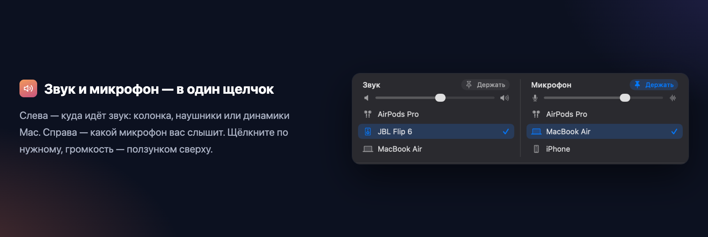
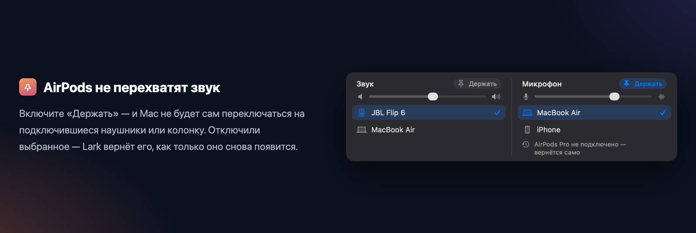

<p align="center"></p>

<h1 align="center">Lark</h1>

<p align="center"><b>Звук, микрофон и всё, что играет на Mac, — в одном щелчке.</b><br>
Бесплатно, для Mac с macOS 14.2 Sonoma и новее. Без аккаунтов и рекламы, в интернет ничего не отправляет.</p>

<p align="center"><a href="https://eglibyte.ee/lark.html">Страница программы</a> · <a href="https://eglibyte.ee/ru/lark.html">на русском</a> · <a href="https://eglibyte.ee/en/lark.html">in English</a></p>


## Что это и зачем

Подключили AirPods — и Mac сам перекинул на них звонок, хотя вы говорили в микрофон ноутбука. Где-то играет музыка, а вы не помните, в какой вкладке. В Telegram пошёл кружочек, а в Spotify ещё песня.

Lark (по-английски «жаворонок») собирает всё это в одну панель в строке меню: куда идёт звук, какой микрофон вас слышит и что сейчас играет — с паузой у каждой строки.

## Что умеет






## Как установить

1. Откройте **Терминал**: Программы → Утилиты → Терминал.
2. Скопируйте туда эту строку и нажмите Enter:

   ```bash
   curl -fsSL https://raw.githubusercontent.com/Egrom92/lark/main/install.sh | bash
   ```

3. Готово: в строке меню появился значок — колонка и микрофон.

Если появится окно с предложением установить инструменты Apple, нажмите «Установить», подождите 5–15 минут и повторите шаг 2. Это бесплатно и нужно один раз.

## Как пользоваться

| Что сделать | Как |
|---|---|
| Открыть панель | щёлкните по значку в строке меню |
| Выбрать, куда идёт звук или какой микрофон слушает | щёлкните по устройству в колонке «Звук» или «Микрофон» |
| Громкость | ползунок над списком устройств |
| Не давать Mac самому переключаться на AirPods | кнопка «Держать» над колонкой |
| Поставить на паузу трек или видео во вкладке | кнопка ⏸ в его строке |
| Выключить звук Telegram, WhatsApp, игры | кнопка с динамиком в строке программы; ещё раз — звук вернётся |
| Перейти к вкладке или программе | щёлкните по названию в строке |
| Играть только это, остальное — на паузу | правый щелчок по строке → «Играть только это» |
| Тишина везде | «Пауза везде» над списком |
| Убрать лишнее устройство из списка | правый щелчок по нему → «Скрыть из списка» |
| Вернуть скрытые, автозапуск, выход | шестерёнка внизу панели |

## Первый запуск: разрешения

Lark спросит их, когда понадобятся. Нажмите «Разрешить», это нужно один раз.

- **«Lark хочет управлять Spotify / Google Chrome / Safari»** — чтобы видеть, что играет, и ставить на паузу.
- **Запись системного звука** — только для кнопки «выключить звук» у программ вроде Telegram. Lark ничего не записывает: так macOS называет доступ к звуку других программ.
- **Чтобы видеть отдельные вкладки браузера**, включите в нём один пункт меню (Lark подскажет прямо в панели):
  - Chrome: **Вид → Разработчик → Разрешить JavaScript из Apple Events**;
  - Safari: **Разработка → Разрешить JavaScript из Apple Events** (меню «Разработка» включается в Safari → Настройки → Дополнения).

## Частые вопросы

**Какие программы Lark видит?** Spotify и Музыку — с названием трека; Chrome, Safari, Arc, Brave, Edge, Яндекс Браузер, Vivaldi и Opera — по вкладкам, с названием видео и значком сайта; любую другую программу — пока она издаёт звук.

**Почему у Telegram нет паузы, а только «выключить звук»?** Telegram, WhatsApp и игры не дают другим программам ставить себя на паузу. Lark выключает звук самой программы. Когда Lark закрывается, звук возвращается сам.

**Почему вкладки браузера не видны?** В браузере выключен пункт «Разрешить JavaScript из Apple Events» — см. «Первый запуск». Видео внутри чужого встроенного плеера на сайте может не определиться.

**Что такое «Держать»?** Mac сам переключает звук и микрофон на только что подключённые наушники или колонку. С «Держать» Lark сразу возвращает выбранное. Если выбранное отключено, Mac выбирает сам, а когда оно появится снова, Lark вернёт его.

**Lark что-то отправляет в интернет?** Нет. Он только скачивает значки сайтов (YouTube, Facebook…) для строк вкладок — прямо с этих сайтов.

**Почему после обновления снова спрашивает разрешения?** Не должен: Lark подписывается одним и тем же ключом на вашем Mac, и macOS его узнаёт.

## Обновить или удалить

**Обновить:** повторите команду установки, настройки сохранятся.

**Удалить** вместе с настройками:

```bash
curl -fsSL https://raw.githubusercontent.com/Egrom92/lark/main/uninstall.sh | bash
```

## Другие программы

- [2pic](https://eglibyte.ee/ru/2pic.html) — скриншоты и видео с экрана
- [Oops](https://eglibyte.ee/ru/oops.html) — исправляет текст, набранный не в той раскладке
- [Peekaboo](https://eglibyte.ee/ru/peekaboo.html) — прячет лишние значки в строке меню
- [Magpie](https://eglibyte.ee/ru/magpie.html) — помнит всё, что вы копировали

Все программы: [eglibyte.ee/ru/tools.html](https://eglibyte.ee/ru/tools.html)

<sub>Бесплатно, лицензия [MIT](LICENSE). Для разработчиков: проверки — `./scripts/test.sh`, картинки — `./scripts/make-docs.sh`, диагностика на своём Mac — `open -n -W --stdout /dev/stdout -a Lark --args --probe`.</sub>
