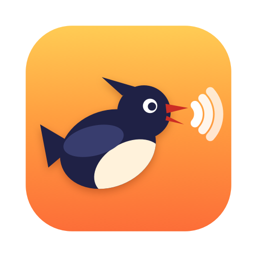
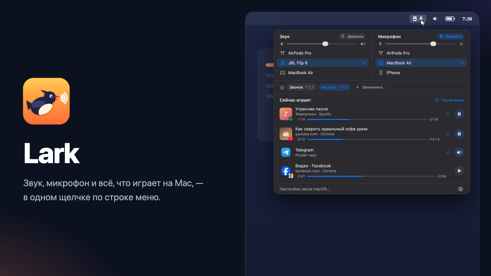
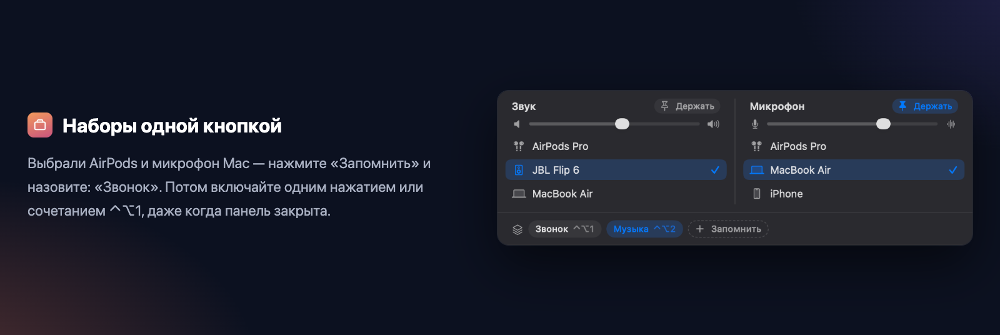
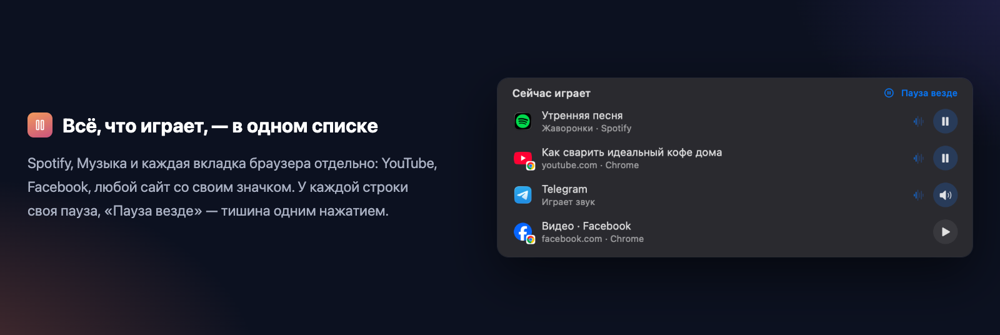
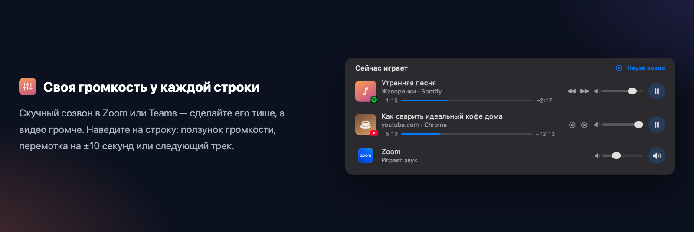
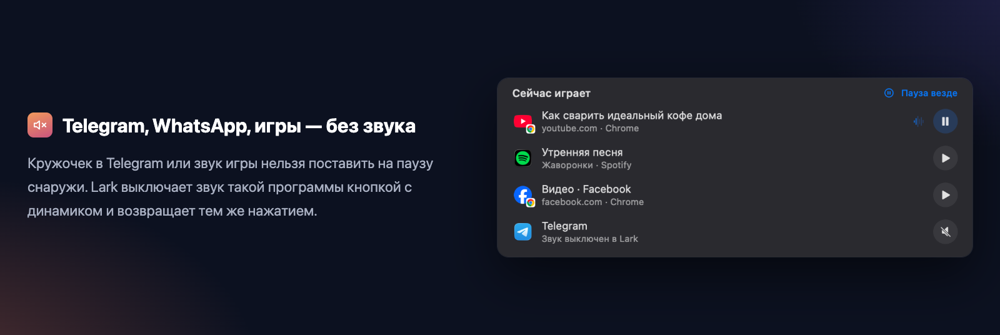

<p align="center"></p>

<h1 align="center">Lark</h1>

<p align="center"><b>Звук, микрофон и всё, что играет на Mac, — в одном щелчке.</b><br>
Бесплатно, для Mac с macOS 14.2 Sonoma и новее. По-русски, по-английски и по-эстонски. Без аккаунтов и рекламы.</p>

<p align="center"><a href="https://eglibyte.ee/lark.html">Страница программы</a> · <a href="https://eglibyte.ee/ru/lark.html">на русском</a> · <a href="https://eglibyte.ee/en/lark.html">in English</a></p>



## Что это и зачем

Подключили AirPods — и Mac сам перекинул на них звонок, хотя вы говорили в микрофон ноутбука. Где-то играет музыка, а вы не помните, в какой вкладке. Скучный созвон в Zoom громче видео, которое вы смотрите.

Lark (по-английски «жаворонок») собирает всё это в одну панель в строке меню: куда идёт звук, какой микрофон вас слышит и что сейчас играет — с паузой, перемоткой и своей громкостью у каждой строки.

## Что умеет











## Как установить

1. Откройте **Терминал**: Программы → Утилиты → Терминал.
2. Скопируйте туда эту строку и нажмите Enter:

   ```bash
   curl -fsSL https://raw.githubusercontent.com/Egrom92/lark/main/install.sh | bash
   ```

3. Готово: в строке меню появился значок — колонка и микрофон.

Если появится окно с предложением установить инструменты Apple, нажмите «Установить», подождите 5–15 минут и повторите шаг 2. Это бесплатно и нужно один раз.

## Как пользоваться

| Что сделать | Как |
|---|---|
| Открыть панель | щёлкните по значку в строке меню |
| Громкость без панели | крутите колесо мыши (или двумя пальцами) над значком |
| Выбрать, куда идёт звук или какой микрофон слушает | щёлкните по устройству в колонке «Звук» или «Микрофон» |
| Запомнить пару «выход + микрофон» | выберите их и нажмите «＋ Запомнить» под колонками |
| Включить набор | щёлкните по нему или нажмите ⌃⌥1, ⌃⌥2… — работает и при закрытой панели |
| Изменить или удалить набор | правый щелчок по нему |
| Не давать Mac самому переключаться на AirPods | кнопка «Держать» над колонкой |
| Пауза у трека или видео | кнопка ⏸ в его строке |
| Перемотать | щёлкните по полоске времени |
| Следующий трек, ±10 секунд, громкость строки | наведите мышь на строку |
| Тише или громче Zoom, Teams, Telegram, игру | наведите на строку программы — ползунок громкости |
| Выключить звук программы | кнопка с динамиком в её строке; ещё раз — звук вернётся |
| Spotify в наушники, а Zoom или фильм в плеере — в колонку | наведите на строку программы → значок выхода → устройство. Lark запомнит |
| Одна вкладка Chrome в наушники, другая — в колонку | поставьте «Lark для Chrome» (ниже), затем правый щелчок по странице → «Lark: звук этой вкладки» |
| Перейти к вкладке или программе | двойной щелчок по строке |
| Играть только это, остальное — на паузу | правый щелчок по строке → «Играть только это» |
| Тишина везде | «Пауза везде»; второе нажатие вернёт как было |
| Убрать лишнее устройство из списка | правый щелчок по нему → «Скрыть из списка» |
| Язык, автозапуск, обновление, выход | шестерёнка внизу панели |

## Первый запуск: разрешения

Lark спросит их, когда понадобятся. Нажмите «Разрешить», это нужно один раз.

- **«Lark хочет управлять Spotify / Google Chrome / Safari»** — чтобы видеть, что играет, ставить на паузу, перематывать и менять громкость.
- **Запись системного звука** — только для громкости и выключения звука у программ вроде Zoom или Telegram. Lark ничего не записывает: так macOS называет доступ к звуку других программ.
- **Чтобы видеть отдельные вкладки браузера**, включите в нём один пункт меню (Lark подскажет прямо в панели):
  - Chrome: **Вид → Разработчик → Разрешить JavaScript из Apple Events**;
  - Safari: **Разработка → Разрешить JavaScript из Apple Events** (меню «Разработка» включается в Safari → Настройки → Дополнения).

## Lark для Chrome: звук отдельной вкладки

Chrome выводит звук всех вкладок одним общим потоком, поэтому развести вкладки по устройствам может только расширение внутри Chrome. Оно ставится вместе с Lark:

1. В Lark: шестерёнка → **«Lark для Chrome: звук отдельной вкладки…»** — откроются страница расширений Chrome и папка с расширением.
2. В Chrome включите **«Режим разработчика»** (справа вверху) и нажмите **«Загрузить распакованное расширение»**, выберите показанную папку `Chrome`.
3. Нажмите **«Разрешить»** на открывшейся странице: без этого Chrome не показывает расширениям названия колонок и наушников. Микрофон сразу отпускается, ничего не записывается.

Дальше: правый щелчок по странице → **«Lark: звук этой вкладки»** → устройство (или значок расширения на панели Chrome). В панели Lark у вкладки появится «→ JBL». «Как у всех» — вернуть обратно. Работает в Chrome, Brave, Edge и Arc; в Safari такого механизма нет.

## Частые вопросы

**Какие программы Lark видит?** Spotify и Музыку — с названием трека, обложкой и временем; Chrome, Safari, Arc, Brave, Edge, Яндекс Браузер, Vivaldi и Opera — по вкладкам, с превью видео и значком сайта; любую другую программу — пока она издаёт звук.

**Почему у Telegram и Zoom нет паузы?** Они не дают другим программам ставить себя на паузу. Lark меняет громкость самой программы или выключает её звук. Когда Lark закрывается, звук возвращается как был.

**Как сделать Zoom тише, а видео громче?** Наведите мышь на строку Zoom и сдвиньте её ползунок влево. Общую громкость Mac можно поднять колесом над значком Lark.

**Можно YouTube в наушники, а фильм в колонку?** Если это разные программы (Spotify и плеер, Chrome и Safari) — да, в самом Lark: значок выхода в строке программы. Если обе вкладки в одном Chrome — да, с расширением «Lark для Chrome» (см. выше). Bluetooth-наушники и Bluetooth-колонка вместе работают; между устройствами может быть небольшая разница во времени.

**Что такое наборы?** Запомненная пара «куда идёт звук + какой микрофон». Например, «Звонок» — AirPods и микрофон Mac, «Музыка» — колонка. Первые девять наборов включаются сочетаниями ⌃⌥1…⌃⌥9.

**Что такое «Держать»?** Mac сам переключает звук и микрофон на только что подключённые наушники или колонку. С «Держать» Lark сразу возвращает выбранное. Если выбранное отключено, Mac выбирает сам, а когда оно появится снова, Lark вернёт его.

**Почему вкладки браузера не видны?** В браузере выключен пункт «Разрешить JavaScript из Apple Events» — см. «Первый запуск». Видео внутри чужого встроенного плеера на сайте может не определиться.

**Lark что-то отправляет в интернет?** Нет. Он скачивает значки сайтов и обложки для строк — прямо с этих сайтов — и раз в неделю смотрит на GitHub, вышла ли новая версия. О вас при этом ничего не передаётся.

**На каком языке Lark?** Как в системе: русский, английский или эстонский. Поменять — шестерёнка → «Язык».

## Обновить или удалить

**Обновить:** когда выйдет новая версия, у шестерёнки появится оранжевая точка и кнопка «Обновить до …» — Lark обновится и перезапустится сам. Или повторите команду установки. Настройки и наборы сохранятся.

**Удалить** вместе с настройками:

```bash
curl -fsSL https://raw.githubusercontent.com/Egrom92/lark/main/uninstall.sh | bash
```

## Другие программы

- [2pic](https://eglibyte.ee/ru/2pic.html) — скриншоты и видео с экрана
- [Oops](https://eglibyte.ee/ru/oops.html) — исправляет текст, набранный не в той раскладке
- [Peekaboo](https://eglibyte.ee/ru/peekaboo.html) — прячет лишние значки в строке меню
- [Magpie](https://eglibyte.ee/ru/magpie.html) — помнит всё, что вы копировали

Все программы: [eglibyte.ee/ru/tools.html](https://eglibyte.ee/ru/tools.html)

<sub>Бесплатно, лицензия [MIT](LICENSE). Для разработчиков: проверки — `./scripts/test.sh`, картинки — `./scripts/make-docs.sh`, значок — `swift scripts/make-icon.swift`, диагностика на своём Mac — `open -n -W --stdout /dev/stdout -a Lark --args --probe` (или `--selftest`).</sub>
